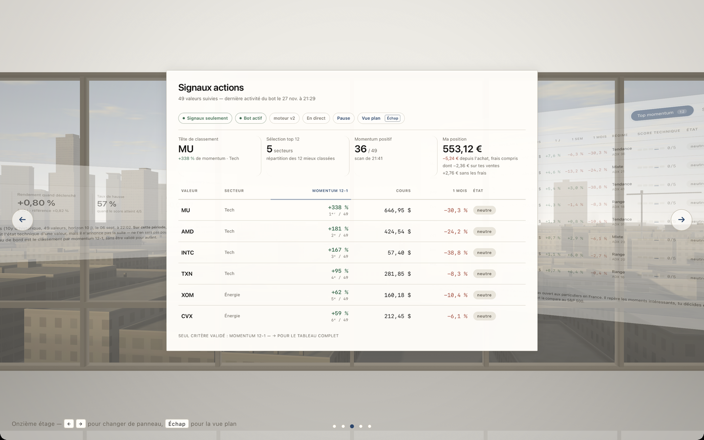
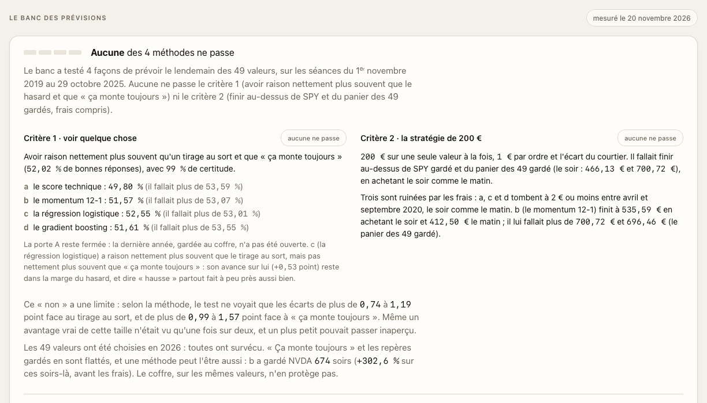
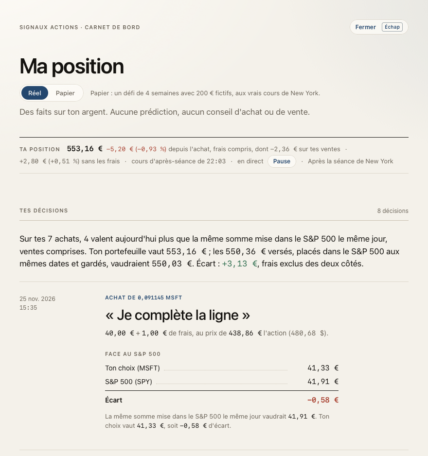
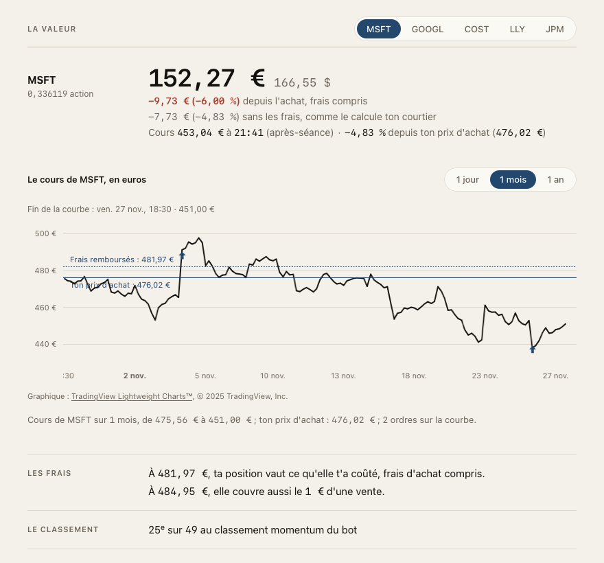
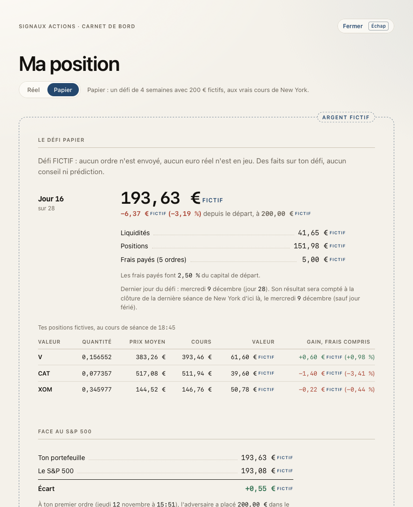
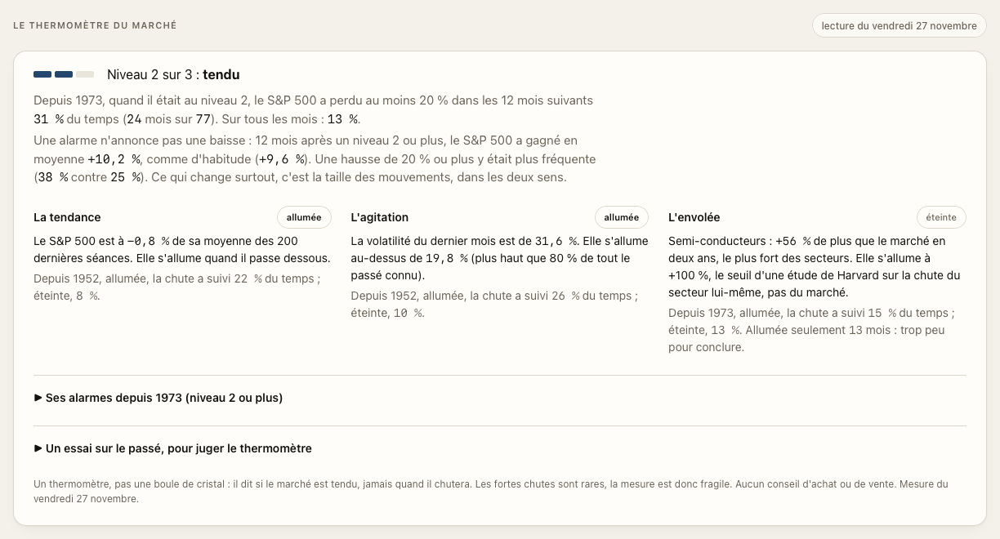

# Signaux actions

**Stock signals, measured before they are trusted.**
Python · pandas · WebGL2 · PyObjC · Lightweight Charts — by [Mathis Soupizon](https://patapain18.github.io/#signaux-actions)



A bot scans **49 large US companies every five minutes**, ranks them by
momentum and technical state, and tells me what moved. **It places no order:**
I decide, by hand, at my broker. Its dashboard is a native macOS app: where I
stand in euros, each decision I took compared with the S&P 500, a four-week
challenge with fictional money, and a few measurements of the market, each
one dated and sourced.

The part that matters most is the measurement. A signal that has not been
measured is an opinion, so every ranking is replayed session by session
against 200 shuffled versions of itself — the same signals, handed to the
wrong stocks — and compared with simply holding everything.

> The screenshots come from a demo server: the journal, the positions and the
> paper challenge are invented. The prices and the market data are real
> (Yahoo Finance, 27 November 2026).

## What the measurements say

- **The engine's own score has no detectable predictive power**
  (information coefficient −0.024 over ten years, 10-day horizon, audit of
  7 September 2026). It describes the technical state of a stock; it does not
  announce what comes next, and the dashboard says so.
- **12-1 momentum beats chance, not the basket.** It beats its 200 shuffled
  versions, but its risk-adjusted return is indistinguishable from holding the
  49 stocks in equal weights (Sharpe 0.932 against 0.935), and its edge
  shrinks about sixfold once survivorship bias is removed. It orders the table
  as the least bad criterion measured, never as a buy signal.
- **No forecasting method passes the bench.** On 20 November 2026, four ways
  of predicting the next session — the technical score, momentum, a logistic
  regression and gradient boosting — were run once, on rules written before
  looking, over the sessions from November 2019 to October 2025. None was
  right clearly more often than a random draw and than "it always goes up";
  none made a 200 € one-stock-at-a-time strategy end above both SPY and the
  equal-weight basket, fees included. The last year, kept aside as a vault,
  was never opened. The limit: depending on the method, the test could only
  see an edge of about one to one and a half percentage points, and even
  that only half the time.
- **At this size, fees are a wall.** With 1 € per order plus the broker's
  spread, a stock has to rise by more than 1.1 % before buying and selling it
  with 200 € earns anything, and by more than 4.2 % with 50 €. The dashboard
  measures how often one of the 49 rises that much within a quarter of an
  hour, 45 minutes or a whole session.
- **Post-earnings drift (PEAD)** was tested with the same protocol and
  rejected: indistinguishable from chance on large caps, with more than twice
  the turnover.



The full log, in French, with the audits that overturned earlier claims:
[docs/notes.md](docs/notes.md).

## What it shows

### My position, and each decision against the S&P 500



Each order I place at my broker goes into a journal, with the euros actually
paid, the fees and one sentence: why. Each purchase is compared with the same
amount put into the S&P 500 (SPY) at the same minute, and the whole portfolio
with the money actually paid in, placed in the S&P 500 on the same dates.
Fees count everywhere; a "without fees" figure sits next to the main one,
computed the way the broker shows it.



The chart is TradingView's Lightweight Charts™: each order at its own price on
the curve, the purchase price and the line where the fees are paid back, over
one day, one month or one year, following the real New York sessions — short
ones included.

### A paper challenge



Four weeks with 200 € of fictional money, at real New York prices and 1 € per
order. The first order buys the S&P 500 for the opponent at the same minute.
The result is split in three — before fees, the fees, the 31.4 % French flat
tax — next to the share of chance: what a random stock among the 49, held
twenty sessions, did against the S&P 500 over the last two years.

### The market, in facts



- **The thermometer**: three needles on the S&P 500, read with nothing but the
  past known at the time — the trend (below its 200-day average), the
  agitation (one-month volatility above 80 % of its history), the run-up of a
  sector (100 % more than the market in two years). For each, how often a
  fall of 20 % or more followed within a year, and how often it did not. The
  bot measures it again, on a weekend, once the reading is a month old.
- **The drawdown**: how far the S&P 500 and the Nasdaq Composite are from
  their record close, and every finished fall of 20 % or more since 1927 and
  1971, with how long the way back took.
- **The weekly summary**, written by the bot every Sunday evening: the indices
  in dollars and in euros, the biggest moves, the sectors, the momentum
  ranking, the results coming up.
- **Live prices**: during the New York session, the position and the table of
  49 follow Yahoo's streaming feed within seconds; if it goes silent, the app
  falls back to one-minute bars and says so. A Pause button stops it.

None of it says what to buy or sell, or when a fall will come.

### The room

The main view is a room on an eleventh floor: five glass panels hanging in
front of a procedural city drawn in raw WebGL2, lit by the real position of
the sun (never at night), with two shadow maps and passing clouds. The arrow
keys turn from panel to panel; Escape opens the plan view, where every
section lives.

## How it works

| Part | Files |
|---|---|
| The scanner, run every five minutes by `launchd` | `stock_bot.py` |
| The signal engine: regime detection (ADX), distances in ATR, volume confirmation, rolling calibration | `stock_engine.py` |
| The measurement: replay, information coefficient, random and permutation nulls, bootstrap | `stock_eval.py`, `pead_test.py` |
| The forecasting bench and the fee wall | `banc.py`, `banc_methodes.py`, `banc_argent.py`, `seance.py` |
| My position, the journal and the duel with the S&P 500 | `ma_position.py` |
| The paper challenge | `papier.py` |
| The thermometer, the drawdown, the weekly summary | `thermometre.py`, `creux.py`, `point_semaine.py` |
| Live prices (Yahoo's streaming feed) | `cours_direct.py` |
| The dashboard server (local only, `127.0.0.1:8770`) | `web/server.py`, `web/static/` |
| The chart, on Lightweight Charts 5.3.0 (vendored) | `web/static/ma-position/graphe.js`, `web/static/vendor/` |
| The room: raw WebGL2, procedural city, NOAA sun position, two shadow maps | `web/static/vue3d.js`, `web/static/vue3d_ville.js` |
| The native window (WKWebView through PyObjC) | `web/dashboard_app.py`, `web/fenetre_native.py` |

Most modules check themselves with cases computed by hand:
`python3 ma_position.py --verifier`, and the same option on
`papier.py`, `stock_bot.py`, `thermometre.py`, `creux.py`, `seance.py`,
`banc.py`, `cours_direct.py` and `simulateur_200.py`.

It started in April 2026 as crypto bots — grid, scalping, machine learning —
with a backtester to compare them. They are still here (`bot.py`,
`grid_bot.py`, `backtester.py`, `ml_backtester.py`, `compare_strategies.py`),
no longer wired to the dashboard.

## Run it

```bash
pip3 install -r requirements.txt                  # exact versions, tested with the Python 3.9 of macOS
python3 stock_bot.py                              # the scanner, every five minutes, in the terminal
python3 web/server.py                             # the dashboard → http://127.0.0.1:8770
python3 stock_eval.py --period 5y --horizon 10    # measure the signal
```

On my Mac the bot runs under `launchd` and looks after itself: it trims its
own log, measures the thermometer again when the reading is a month old, and
no longer mistakes a stale PID file for a running bot after a restart. The
interface is in French. API keys live in `.env`, never in the repository
(template: `.env.example`); `data/` and `logs/` stay on the machine that runs
the bot.

## Data and licences

- Prices and market data: Yahoo Finance, through
  [yfinance](https://github.com/ranaroussi/yfinance) and Yahoo's streaming feed.
- The chart: [Lightweight Charts™](https://www.tradingview.com/lightweight-charts/)
  by TradingView, Apache License 2.0. Its `LICENSE` and `NOTICE` are in
  `web/static/vendor/lightweight-charts-5.3.0/`.
- This is a personal research project, **not financial advice**: the
  dashboard states facts about the past, never what to buy or sell, and no
  forecast.

---

## En français

**Des signaux boursiers, mesurés avant d'être crus.** Un bot scanne 49 grandes
valeurs américaines toutes les cinq minutes, les classe par momentum et par
état technique, et ne passe aucun ordre : c'est moi qui décide, à la main.
Autour de lui, une appli macOS : ma position en euros, chaque décision face au
S&P 500, un défi de quatre semaines en argent fictif, le thermomètre et le
creux du marché, le point de la semaine, les cours en direct. Sa vue
principale est une pièce : des panneaux de verre devant une ville dessinée en
WebGL2 brut, avec le vrai soleil.

Le cœur du projet, c'est la mesure : chaque classement est rejoué séance par
séance face à 200 versions mélangées de lui-même — les mêmes signaux,
attribués aux mauvaises valeurs. Verdict honnête : le score du moteur ne
prédit rien de décelable ; le momentum 12-1 bat le hasard, mais pas le simple
panier équipondéré une fois le risque compté ; aucune des quatre méthodes du
banc des prévisions ne passe ; à 200 €, les frais sont un mur ; le PEAD est
écarté. Rien, dans l'appli, ne dit quoi acheter ni quand le marché chutera.

Les captures viennent d'un serveur de démonstration : le journal, les
positions et le défi papier sont inventés, les cours sont réels.

Le mode d'emploi au quotidien, toutes les mesures et leur historique :
[docs/notes.md](docs/notes.md).
